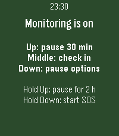
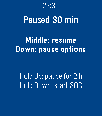
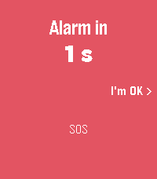
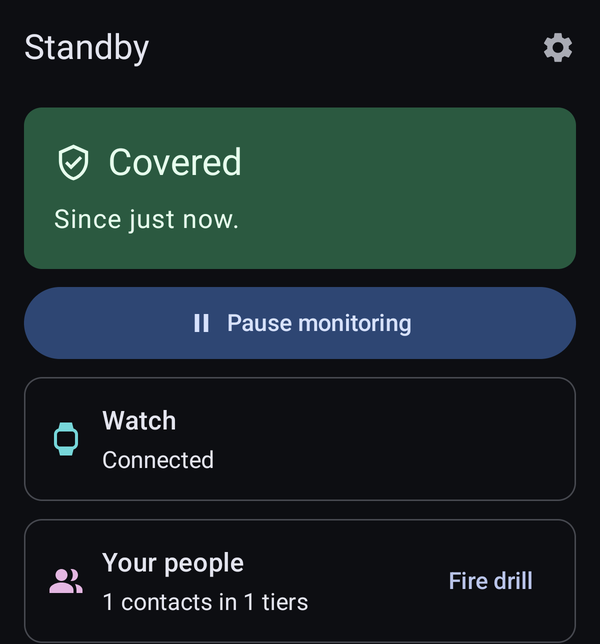
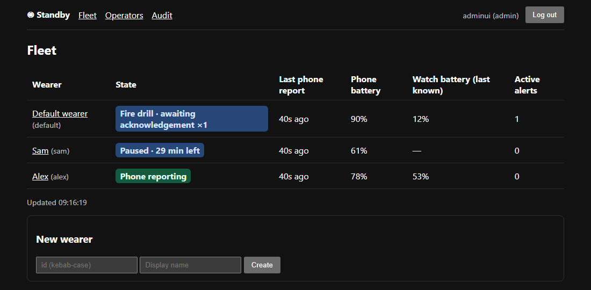

# Standby

**An unresponsiveness alarm for Pebble.** If your pulse signal
disappears while you are still, if the watch registers a hard impact
followed by immobility, if you stop moving for too long, or if you miss
a check-in, the watch asks "Are you OK?", counts down, and only then
the phone alerts the people you chose — relatives first, then, if you
want, an organisation on standby. Humans decide what happens next; the
system never auto-dials emergency services.

Built first for **cryonicists**, whose standby team must be reached
within minutes of unresponsiveness. Useful to anyone whose plan is
"call my people, not an ambulance". Formerly *Pebble Cryonics
Monitor*; the old GitHub URL redirects.

Runs on Pebble Time 2, Pebble 2 HR, Pebble 2 Duo and Pebble Round 2,
an Android companion app, and an optional self-hosted server.

> **This is not a medical device.** It does not diagnose cardiac arrest or
> any medical condition. Optical wrist sensors lose signal both when
> perfusion stops *and* when the strap is loose — the multi-stage
> confirmation ladder exists precisely because the two are indistinguishable
> at the sensor. Treat it as a personal alarm, not a monitor of record.

## Downloads

Start with the [Standby UI beta](https://github.com/Dreamkeeper/pebble-standby/releases/tag/standby-2026.11.25-beta.1). Install the watchapp **0.5.17** (`.pbw`) and Android companion **0.7.0, build 60** (`.apk`) from the same release. This UI update works with your existing Standby firmware. See the [beta installation guide](docs/BETA-TESTER-KIT.md).

The [Time 2 pulse-recovery diagnostic](https://github.com/Dreamkeeper/pebble-standby/releases/tag/pulse-shadow-2026-11-12) is an archived field trial. Its watchapp left only 192 B of free worker heap on the test watch. The [0.5.15 rollback watchapp](https://raw.githubusercontent.com/Dreamkeeper/pebble-standby/3fe9b0c4fcc0565c8895ed8f7ede4c3bb0f18d12/dist/standby-v0.5.15.pbw) restored 896 B on that device.

New builds are published on [GitHub Releases](https://github.com/Dreamkeeper/pebble-standby/releases).

## Screenshots

**Watchapp 0.5.18 preview** on the Pebble Time 2 emulator. From the main screen, one short press of **Up** pauses monitoring for 30 minutes. Press the middle button to resume.

| Monitoring | After one press of Up | SOS countdown |
| :---: | :---: | :---: |
|  |  |  |

**Android companion.** Home on a Xiaomi 17 Ultra (0.7.0 build 59).



**Web dashboard.** In this example, one wearer has a fire drill awaiting acknowledgement, another has paused monitoring, and the third wearer’s phone is reporting. The dashboard is running locally with fictional wearer data.



## Components

| Directory | What it is |
|---|---|
| [`watchapp/`](watchapp/) | Pebble app (C, SDK 4.x): background-worker monitoring (71 ms alarm-path launch, measured), on-watch alert ladder with acknowledged delivery + episode identity, monotonic detector clock (wall-jump immune), sustained-motion and own-vibration guards, suspension menu, carry mode, charging hold, HR-quality gate, not-worn and sensor-fault nags. Targets `emery`, `diorite`, `flint`, `gabbro`. |
| [`android/`](android/) | Android companion (Kotlin): foreground service with Doze-proof exact-alarm heartbeat, watch watchdog + self-heal, full-screen alarm with cancel window, DataLogging spool recovery (alarms escalate even if the watch died out of range), sync-only liveness until the watch's reports arrive, boot/update recovery, soak-test instrumentation with built-in drills, Telegram/server escalation, enrollment-by-code onboarding. SMS/call fallback is parked until a dedicated gateway flavor (Play Protect flags those permissions). |
| [`server/`](server/) | Self-hosted backend (Python/FastAPI, Docker): phone dead-man monitoring with auto all-clear on recovery, tiered escalation with delivery ACK + retry via Telegram/ntfy/email, idempotent alarm intake, leased command queue, web dashboard. Deployed on a Synology NAS behind HTTPS. |
| [`docs/`](docs/) | Product plan, soak-test protocol, deployment guides ([VPS](docs/DEPLOY-VPS.md), [Synology](docs/DEPLOY-SYNOLOGY.md)), [Telegram bot setup](docs/TELEGRAM-BOT.md), review/optimization records, upstream-PR docs. |
| [`openspec/`](openspec/) | Living specs ([OpenSpec](https://github.com/Fission-AI/openspec)): product requirements, detector ladder, watch↔phone protocol, escalation/dead-man, suspension, companion resilience. Changes flow through `/opsx:propose` → `/opsx:apply` → `/opsx:archive`. |
| [`tools/`](tools/) | `worker_log_timeline.py`: rebuilds the watch worker's per-minute timeline from shared companion logs, for post-mortems without ADB. `quiet_record.py`: the per-wearer quiet record (days and nights watched, questions, countdowns, alarms, alarms sent to contacts) from the same logs; see [docs/BETA-TESTER-KIT.md](docs/BETA-TESTER-KIT.md). |
| [`dist/`](dist/) | Earlier sideload builds retained for existing download links. |

## Design lineage

- Alarm state machine, watchdog and escalation patterns ported from
  [OpenSeizureDetector](https://github.com/OpenSeizureDetector) (GPL-3.0).
- Alert-ladder UX modeled on Google Pixel Watch Loss of Pulse Detection
  (FDA De Novo) and Apple Watch Fall/Crash Detection.
- Detection thresholds informed by [cryonicsmonitoring.org](https://www.cryonicsmonitoring.org)
  and the Cryonics Institute Check-In escalation ladder.

## Status

**UI beta, 25 November 2026.** Watchapp 0.5.17 launched on a physical Pebble Time 2, and Android companion 0.7.0 build 60 was installed on a Xiaomi 17 Ultra. The tagged source includes the matching web dashboard (server 0.3.7). Free worker heap on the physical Time 2 with 0.5.17 still needs measurement.

An earlier seven-day field run recorded 10,032 worker reports, zero false alarms and zero heartbeat gaps. Battery life was about 4.7 days against a seven-day target. These measurements predate the UI beta.

What the field testing taught, each with a fix and a test:

- **Alarm delivery hardening** — every escalation episode carries a
  minted ID end-to-end; the watch retries PRE_ALARM/ALARM/CANCEL with
  backoff until the phone ACKs; the DataLogging spool doubles as an
  authoritative alarm recovery path; detectors run on a monotonic clock.
- **False-alarm classes closed** — a sleeping wearer's steady pulse is
  not "not worn" (the 1 Hz hunt arbitrates first); a desk bump or a bed
  partner turning is not "I'm fine" (only sustained motion dismisses);
  the alert's own vibration is never motion (announced to the worker,
  since the firmware flag dies for workers); the alarm clock is not a
  shock; an impact check-in ends only on a button press; a set-down
  shock is not a
  fall; sensor-fault vs not-worn discrimination; per-sample HR-quality
  gating validated against a 450-sample sensor lab; carry mode.
- **Survivability** — phone reboot/app-update recovery, Doze-proof
  heartbeats, provisioning watchdog with self-heal, worker heap
  telemetry within the 10.5 KB worker budget, soak counters and drills
  in the app, sync-only liveness until the Pebble app delivers the
  watch's reports, and diagnostics the wearer chooses to share
  (redacted on the phone; the server can ask, never pull).
- **Server hardening** — dead-man race fixes, idempotent alarm intake,
  leased commands, auto-resolve + all-clear when a silent phone
  recovers, per-wearer event isolation.

### Upstream support

| Change | Status and effect on Standby |
|---|---|
| [PebbleOS #1960](https://github.com/coredevices/PebbleOS/pull/1960) | **Merged into main on 18 November 2026.** When the sensor reports off-wrist, firmware clears the cached raw heart rate and confidence so a watchapp can stop seeing the last on-wrist reading. The [v4.47.3 release source](https://github.com/coredevices/PebbleOS/blob/v4.47.3/pebble/services/activity/activity.c) still uses the earlier callback. |
| [Pebble mobile app #378](https://github.com/coredevices/mobileapp/pull/378) | **Merged on 17 September 2026.** The Pebble app delivers third-party watch reports to Android companions over PebbleKit 2. Standby uses this path. The change is present in [mobile app tag 1.18.0](https://github.com/coredevices/mobileapp/tree/1.18.0). |
| [Pebble mobile app #386](https://github.com/coredevices/mobileapp/pull/386) | **Closed without merging.** This was Standby’s earlier proposal to forward reports through classic Android broadcasts. Upstream adopted PebbleKit 2 in #378. |

See [docs/SOAK-TEST.md](docs/SOAK-TEST.md) for the soak protocol and
[docs/PLAN.md](docs/PLAN.md) for the roadmap, and
[docs/DESIGN.md](docs/DESIGN.md) for the UI/UX design pass that the
Compose rebuild of the companion follows.

## Building

**Watchapp** (pebble-tool 5.x + SDK 4.9.169+, Linux/WSL):

```bash
cd watchapp && pebble build     # -> build/watchapp.pbw (emery/diorite/flint/gabbro)
```

Install: sideload the `.pbw` via the Pebble/Core mobile app or
Rebble Sideload Helper.

**Android companion** (JDK 17, Android SDK platform 37, Gradle 9.6+, AGP 9.3 —
PebbleKit2 ≥ 1.3 requires compileSdk 37):

```bash
cd android && gradle assembleSideloadRelease
# -> app/build/outputs/apk/sideload/release/app-sideload-release.apk
```

**Server** (Docker; see [docs/DEPLOY-VPS.md](docs/DEPLOY-VPS.md) for a public
VPS with automatic HTTPS, [docs/DEPLOY-SYNOLOGY.md](docs/DEPLOY-SYNOLOGY.md)
for Synology Container Manager and
[docs/SERVER-DEPLOYMENT.md](docs/SERVER-DEPLOYMENT.md) for the update
procedure):

```bash
cd server && cp .env.example .env   # set CM_API_TOKEN etc.
docker compose up -d --build        # API on :8080, ntfy on :8090
```

The UI beta has 275 [watch detector checks](watchapp/tests), 55 [Android unit tests](android/app/src/test) and 108 [server tests](server/tests).

Internal identifiers (Android package `org.cryomonitor.companion`,
server module and container names, the watchapp UUID) deliberately keep
their original names so existing installs and enrollments carry over.

## License

GPL-3.0 — see [LICENSE](LICENSE).
